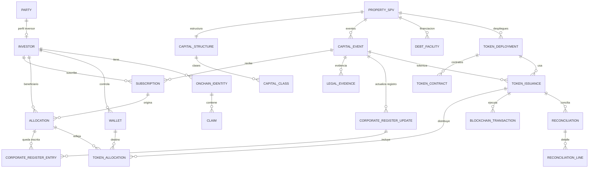

# Modelo de datos v0.3 — Capital Management & Token Issuance

## 1. Objetivo y principios

Este documento define el modelo relacional que deberá implementarse en PostgreSQL mediante Prisma para soportar el flujo vertical v0.3.

Principios:
1. Separar datos financieros, societarios, de identidad y de ejecución blockchain.
2. No convertir una suscripción en una posición societaria sin aprobación/evidencia.
3. No derivar titularidad jurídica del saldo on-chain.
4. Mantener histórico de movimientos y transiciones; no sobrescribir hechos.
5. Usar precisión decimal para dinero e enteros para unidades.
6. Guardar transacciones y resultados blockchain como hechos técnicos inmutables.
7. No persistir claves privadas, secretos de firma, documentos KYC ni datos personales completos.
8. Toda operación sensible debe ser trazable y correlacionable.

## 2. Contextos y agregados

| Agregado | Raíz | Responsabilidad |
|---|---|---|
| SPV | PropertySPV | Vehículo y relación con capital |
| Capital | CapitalEvent | Operación societaria y participaciones legalmente creadas |
| Suscripción | Subscription | Compromiso económico del inversor |
| Asignación | Allocation | Unidades societarias aprobadas |
| Identidad | OnchainIdentity | Identidad on-chain, wallet y claims por red |
| Deployment | TokenDeployment | Despliegue de una suite en una red |
| Emisión | TokenIssuance | Orden de emisión digital |
| Transacción | BlockchainTransaction | Envío y confirmación EVM |
| Conciliación | Reconciliation | Resultado comparativo por asignación |

Las relaciones entre agregados no implican una única transacción de base de datos. Cada comando debe declarar su límite transaccional y publicar eventos mediante Outbox.

## 3. Modelo lógico

## 4. Entidades y campos

Los campos indicados son el baseline funcional; los nombres definitivos se reflejarán en Prisma.

### 4.1 Party e Investor

La Backend Foundation v0.2 se entregó como artefacto separado, pero no está integrada ni verificada en este repositorio. La relación `Party`–`Investor` queda condicionada a comprobar el código que finalmente se incorpore. Si `Party` no existe o su semántica no es adecuada, se definirá el modelo base antes de crear `Investor`; no se presupone una entidad ya desplegada.

**Investor**
- `id`: UUID.
- `partyId`: FK única a Party.
- `investorType`: PERSON / LEGAL_ENTITY (solo clasificación sintética en laboratorio).
- `status`: ACTIVE / BLOCKED / ARCHIVED.
- timestamps.

No incluir nombre legal, documento identificativo, domicilio o fecha de nacimiento en tablas blockchain-facing. Los datos sintéticos de Party se rigen por el modelo de privacidad del laboratorio.

### 4.2 PropertySPV, CapitalStructure y CapitalClass

**PropertySPV**
- `id`, `code` único, `name`, `jurisdiction`, `legalForm`, `status`.
- `createdAt`, `updatedAt`.

**CapitalStructure**
- `id`, `spvId` único.
- `currency` (EUR en v0.3).
- timestamps.

**CapitalClass**
- `id`, `capitalStructureId`, `code`, `name`.
- `nominalValue`: Decimal.
- `currency`.
- `isActive`.
- En v0.3 se admite una clase ordinaria por SPV; la restricción se valida en el dominio y, cuando proceda, con índice/constraint adicional.

### 4.3 CapitalEvent, Subscription, Allocation y LegalEvidence

**CapitalEvent**
- `id`, `spvId`, `capitalClassId`.
- `eventType`: INITIAL_ISSUANCE en v0.3.
- `legallyCreatedUnits`: BigInt positivo, derivado del acto societario que crea las participaciones; no representa una autorización abstracta de capital.
- Las unidades asignadas se derivan de Allocation; no se mantiene un contador duplicado sin mecanismo transaccional de consistencia.
- `status`: DRAFT / VALIDATED / APPROVED / EXECUTED / CANCELLED.
- `effectiveDate`, timestamps.

**Subscription**
- `id`, `capitalEventId`, `investorId`.
- `requestedUnits`: BigInt.
- `nominalAmount`, `premiumAmount`, `subscriptionAmount`: Decimal.
- `currency`, `status`.
- `paymentReference` opcional y sintética.
- No usar Float para importes.

**Allocation**
- `id`, `subscriptionId`, `investorId`, `units`: BigInt.
- `status`: PROPOSED / APPROVED / REJECTED / CANCELLED.
- `approvedBy`, `approvedAt`, `approvalReference`.
- La suma de asignaciones aprobadas no puede superar las participaciones legalmente creadas y disponibles en el CapitalEvent.

**LegalEvidence**
- `id`, `capitalEventId`, `evidenceType`, `externalReference`.
- `contentHash`, `hashAlgorithm`, `status`, `recordedAt`.
- En el laboratorio se guarda referencia y hash de evidencia sintética; no se suben documentos personales ni se interpreta el hash como prueba jurídica suficiente.

### 4.4 Corporate Registry

**CorporateRegisterUpdate**
- `id`, `spvId`, `capitalEventId`, `status`: PENDING / COMPLETED / REJECTED / SUPERSEDED.
- `effectiveAt`, `recordedAt`, `recordedBy`, `registerReference`.
- `legalEvidenceId` o relación explícita con la evidencia societaria que soporta la inscripción.
- `contentHash` opcional para identificar el extracto sintético, sin tratar el hash como prueba jurídica suficiente.
- Una actualización completada contiene una o varias CorporateRegisterEntry; no basta con registrar un total agregado.

**CorporateRegisterEntry**
- `id`, `corporateRegisterUpdateId`, `allocationId`, `investorId`, `registeredUnits`: BigInt.
- `registerEntryReference`, `effectiveAt`, `status`.
- Unique: (`corporateRegisterUpdateId`, `allocationId`).
- Identifica qué asignación y qué cantidad constan en el registro societario simulado.

### 4.5 DebtFacility

**DebtFacility**
- `id`, `spvId`, `lenderReference`, `currency`.
- `initialPrincipal`, `outstandingPrincipal`: Decimal.
- `rateType`, `interestRate`, `referenceIndex`, `margin`.
- `originationDate`, `maturityDate`, `repaymentProfile`, `status`.
- No tiene relación con Allocation ni TokenAllocation. La deuda nunca incrementa el cap table.

### 4.6 Wallet, OnchainIdentity y Claim

**Wallet**
- `id`, `investorId`, `chainId`: BigInt.
- `address`: dirección EVM normalizada.
- `status`: PENDING / ACTIVE / REVOKED.
- Unique: (`chainId`, `address`).

**OnchainIdentity**
- `id`, `investorId`, `chainId`, `identityAddress`.
- `status`, `createdTransactionId` opcional.
- Unique: (`chainId`, `identityAddress`).
- La relación wallet-identity se registra por deployment en Identity Registry; no asumir que una identidad registrada en una red es válida en otra.

**Claim**
- `id`, `onchainIdentityId`, `topic`: BigInt.
- `issuerAddress`, `claimId`, `validFrom`, `validTo`.
- `revokedAt` opcional, `status`.
- No guardar el payload personal del claim si no es imprescindible para la prueba.

### 4.7 TokenDeployment y TokenContract

**TokenDeployment**
- `id`, `spvId`, `chainId`.
- `protocol`: ERC3643_TREX.
- `protocolVersion`, `sourceCommit`, `packageIntegrity`.
- `compilerVersion`, `optimizerEnabled`, `optimizerRuns`.
- `deploymentStrategy`: LOCAL_SOURCE_DEPLOYMENT en Anvil.
- `status`, `deployerAddress`, `deploymentStartedAt`, `deployedAt`.

**TokenContract**
- `id`, `deploymentId`, `contractType`, `address`.
- `abiVersion`, `artifactHash`, `deploymentTxHash`, `blockNumber`.
- Unique: (`deploymentId`, `contractType`) y (`chainId`, `address`) a través de una clave de red desnormalizada o constraint de aplicación.

No asumir que todos los contratos se despliegan con el mismo patrón proxy/direct implementation. El inventario reflejará los contratos reales devueltos por el deployer de la versión fijada.

### 4.8 TokenIssuance y TokenAllocation

**TokenIssuance**
- `id`, `capitalEventId`, `tokenDeploymentId`.
- `status`: DRAFT / VALIDATION_PENDING / APPROVAL_PENDING / APPROVED / DEPLOYMENT_PENDING / DEPLOYED / IDENTITY_SETUP_PENDING / IDENTITIES_READY / MINT_PENDING / MINT_PARTIAL / MINTED / RECONCILIATION_PENDING / RECONCILED / DISCREPANCY / REJECTED.
- `legallyCreatedUnits`, `mintedUnits`: BigInt; `legallyCreatedUnits` se obtiene del evento societario/evidencia y no de un cupo abstracto.
- `approvedBy`, `approvedAt`, `idempotencyKey` única.
- timestamps.

**TokenAllocation**
- `id`, `tokenIssuanceId`, `allocationId`, `corporateRegisterEntryId`, `walletId`.
- `units`, `mintedUnits`: BigInt.
- `status`: PENDING / READY / SUBMITTED / MINTED / FAILED.
- Unique: (`tokenIssuanceId`, `allocationId`) y `corporateRegisterEntryId` dentro de la emisión.
- El destinatario y las unidades se obtienen de una Allocation aprobada y de su CorporateRegisterEntry completada; no se confía en cantidades arbitrarias enviadas por el frontend.

### 4.9 BlockchainTransaction

- `id`, `tokenIssuanceId`, `tokenDeploymentId`.
- `operationType`: DEPLOY / IDENTITY_REGISTER / CLAIM_ISSUE / MINT.
- `chainId`, `fromAddress`, `toAddress`, `contractAddress`.
- `transactionHash` nullable hasta envío; `nonce`, `blockNumber`, `blockHash`.
- `status`: CREATED / POLICY_PENDING / APPROVED / SIGNING / SIGNED / SUBMITTED / CONFIRMED / REVERTED / SUBMISSION_UNKNOWN / REORGED.
- `receiptStatus`, `gasUsed`, `effectiveGasPrice`, `failureCode`.
- `idempotencyKey` única por comando.
- No persistir private key, raw signing secret ni seed phrase.

### 4.10 Reconciliation y ReconciliationLine

**Reconciliation**
- `id`, `tokenIssuanceId`, `status`: RUNNING / RECONCILED / DISCREPANCY / FAILED.
- `expectedUnits`, `actualUnits`, `differenceUnits`: BigInt.
- `snapshotBlockNumber`, `snapshotBlockHash`, `startedAt`, `completedAt`.

**ReconciliationLine**
- `id`, `reconciliationId`, `allocationId`, `walletId`.
- `expectedUnits`, `actualUnits`, `differenceUnits`: BigInt.
- `status`: MATCH / MISSING / EXCESS / WRONG_WALLET / UNCONFIRMED.

Una conciliación debe identificar el bloque de lectura para hacer reproducible la comparación. La conciliación no corrige automáticamente titularidad o saldos.

## 5. Tipos, precisión y restricciones

| Dato | Tipo recomendado |
|---|---|
| IDs | UUID |
| Unidades de participaciones y tokens | BigInt |
| Importes EUR | Decimal, precisión definida explícitamente |
| Porcentajes | Calculados; no fuente de verdad |
| Chain ID | BigInt |
| Dirección EVM | String validado y normalizado |
| Transaction hash / block hash | String de 32 bytes validado |
| Content hash SHA-256 | String de 32 bytes validado |
| Fechas de negocio | DateTime UTC; fecha efectiva de capital como DateTime |

Prisma `BigInt` se serializa como string en JSON. Las APIs expondrán unidades y chain IDs como strings para evitar pérdida de precisión en clientes JavaScript.

## 6. Integridad e idempotencia

Restricciones mínimas:
- `PropertySPV.code` único.
- `CapitalStructure.spvId` único.
- `Investor.partyId` único.
- `Wallet(chainId, address)` único.
- `TokenContract(deploymentId, contractType)` único.
- `TokenAllocation(tokenIssuanceId, allocationId)` único.
- `TokenIssuance.idempotencyKey` única.
- `BlockchainTransaction(chainId, transactionHash)` único cuando hash no sea null.
- `BlockchainTransaction.idempotencyKey` única.
- Unidades positivas y montos no negativos mediante validación de dominio y constraints SQL donde Prisma no los exprese directamente.

La suma de asignaciones y el control de supply requieren validación transaccional con bloqueo/concurrencia; una validación de aplicación sin protección frente a carreras no es suficiente.

## 7. Auditoría, Outbox e historial

Entidades transversales:
- `AggregateStateTransition`: agregado, ID, estado anterior/nuevo, actor, timestamp, motivo, correlationId.
- `AuditEvent`: actor, acción, recurso, resultado, metadata no sensible.
- `OutboxEvent`: eventId, aggregateType, aggregateId, eventType, schemaVersion, payload, occurredAt, publishedAt, attempts.

La transición de negocio y la escritura del Outbox se harán en la misma transacción PostgreSQL. La publicación a RabbitMQ será asíncrona e idempotente.

## 8. Decisiones que no se deben implementar incorrectamente

1. No guardar `units` como Float, Decimal o string numérico en base de datos: usar BigInt.
2. No guardar importes EUR como Float.
3. No guardar el porcentaje de participación como dato maestro; calcularlo desde unidades válidas y denominador aplicable.
4. No asociar DebtFacility a TokenAllocation.
5. No crear TokenAllocation sin Allocation aprobada.
6. No iniciar mint antes de que Corporate Registry acredite la actualización del Libro Registro de Socios.
7. No actualizar el saldo on-chain en PostgreSQL antes de receipt confirmado.
8. No considerar un timeout como fallo definitivo.
9. No volver a emitir si una transacción anterior tiene resultado indeterminado.
10. No guardar claves ni datos KYC completos en tablas de tokenización.
11. No usar el saldo del token como fuente de verdad de socios de la SL.

## 9. Próximo paso de implementación

Convertir este modelo en `schema.prisma` una vez incorporada y revisada la Backend Foundation v0.2 en el repositorio. Después:
1. generar Prisma Client;
2. validar el schema;
3. crear migración inicial;
4. aplicar migración en PostgreSQL Docker;
5. sembrar escenario sintético RETP001;
6. ejecutar pruebas de constraints, relaciones e invariantes.

**Estado:** modelo lógico y físico propuesto; schema Prisma, migraciones y pruebas todavía no implementados.
